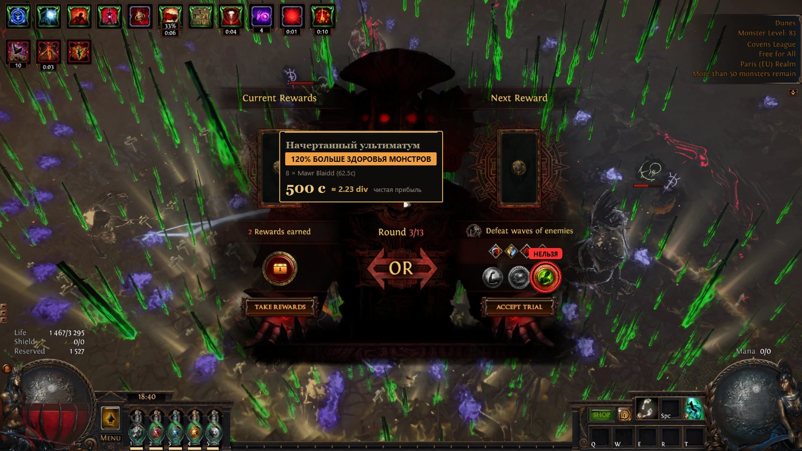
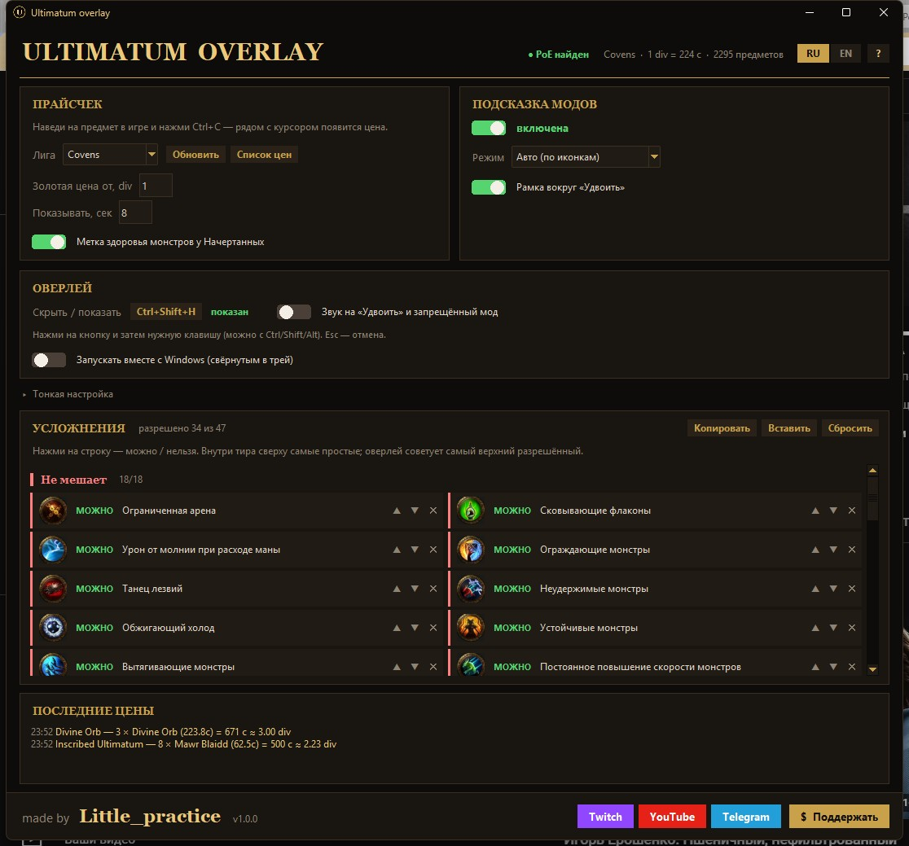

<p align="center"></p>

<p align="center">
  <a href="https://github.com/Little-practice/ultimatum-overlay/releases/latest"><b>⬇ Download / Скачать UltimatumOverlay.exe</b></a>
  &nbsp;·&nbsp; <a href="#русский">Русский</a> &nbsp;·&nbsp; <a href="#english">English</a>
</p>

---

## Русский

**Ultimatum Overlay** — подсказки для Ультиматума в Path of Exile 1 поверх игры.
Программа **ничего не нажимает за игрока**: она только смотрит на экран и в буфер обмена и рисует подсказки.

<p align="center"></p>

### Что умеет
- **Цена по Ctrl+C.** Наведи курсор на предмет в игре и нажми Ctrl+C — рядом появится карточка с ценой poe.ninja
  (с учётом стопки). «Мало данных» — цена по малому числу сделок. Можно вписать свою цену.
- **Начертанный ультиматум:** считается только чистая прибыль, плюс плашка «70 / 120 / 200% больше здоровья монстров».
- **Подсказка модов.** В окне ультиматума обводит самый простой разрешённый мод (10 волн) или пишет «можно / нельзя»
  на выданном (13 волн). Тир-лист из 47 модов, включая моды Миража, — галочки и порядок настраиваются.
- **Рамка вокруг «Удвоить»** (Double Down), чтобы её нельзя было не заметить.
- **Не мешает другим прайсчекерам:** если предмет скопировал другой прайсчекер (Ctrl+D и т. п.), карточка не появится.
- Русский и английский клиент игры, интерфейс RU / EN, трей, автозапуск, обмен настройками («Копировать / Вставить»).

<p align="center"></p>

### Как начать
1. Скачай `UltimatumOverlay.exe` со страницы [Releases](https://github.com/Little-practice/ultimatum-overlay/releases/latest) и запусти.
2. Игра должна быть в режиме **«Оконный»** или **«Оконный без рамки» (Windowed Fullscreen)** — поверх полноэкранного режима оверлей не виден.
3. Вверху окна программы должно гореть «● PoE найден». Подробная инструкция — кнопка «?».

### Безопасность
- Программа не отправляет игре нажатия клавиш и мыши, не читает память игры и не меняет её файлы —
  так же, как популярные прайсчекеры. Интернет нужен только для цен (poe.ninja) и названий предметов (pathofexile.com).
- **Открытый код:** всё, что делает программа, — в файлах этого репозитория.
- **exe собирает GitHub**, а не автор: при выпуске версии сервер GitHub сам собирает программу из этого кода
  ([сборка](.github/workflows/release.yml)). В описании выпуска есть SHA256 — можно сверить со скачанным файлом:
  `Get-FileHash UltimatumOverlay.exe` в PowerShell.
- Можно проверить файл на [VirusTotal](https://www.virustotal.com/). Программы, собранные PyInstaller, иногда ошибочно
  помечаются отдельными антивирусами — это известная особенность упаковщика.
- Настройки хранятся в `%APPDATA%\UltimatumOverlay`, рядом с exe ничего не создаётся.

### Собрать самому
```
pip install -r requirements.txt pyinstaller
python -m PyInstaller --onefile --windowed --name UltimatumOverlay --icon app.ico --add-data "icons;icons_default" --hidden-import pystray._win32 main.py
```
Или запустить из исходников: `python main.py`.

### Ошибки и идеи
[Issues](https://github.com/Little-practice/ultimatum-overlay/issues) — сообщить об ошибке (есть шаблон).

---

## English

**Ultimatum Overlay** shows hints for the Ultimatum mechanic in Path of Exile 1 on top of the game.
It **never presses anything for you**: it only looks at the screen and the clipboard and draws hints.

<p align="center"></p>

### Features
- **Price on Ctrl+C.** Hover an item in game and press Ctrl+C — a poe.ninja price card appears next to the cursor
  (stack-aware). “Little data” marks unreliable prices. You can set your own price.
- **Inscribed Ultimatum:** net profit only, plus a “70 / 120 / 200% more Monster Life” tag.
- **Modifier hints.** In the Ultimatum window it circles the easiest allowed modifier (10 waves) or marks the given one
  as allowed / forbidden (13 waves). 47-modifier tier list incl. Mirage modifiers — toggles and order are editable.
- **Double Down highlight**, so you can't miss it.
- **Plays well with other price checkers:** if another tool copies the item (Ctrl+D etc.), no card pops up.
- Russian and English game clients, RU / EN interface, tray, start with Windows, settings sharing (Copy / Paste).

<p align="center"></p>

### Getting started
1. Download `UltimatumOverlay.exe` from [Releases](https://github.com/Little-practice/ultimatum-overlay/releases/latest) and run it.
2. Run the game in **Windowed** or **Windowed Fullscreen** — the overlay is not visible over exclusive Fullscreen.
3. The top of the program window should show “● PoE found”. Press “?” for a short guide.

### Safety
- It sends no keyboard or mouse input to the game, doesn't read game memory or touch game files — same as popular
  price checkers. Internet is used only for prices (poe.ninja) and item names (pathofexile.com).
- **Open source:** everything the program does is in this repository.
- **The exe is built by GitHub**, not by the author: each release is compiled from this code on GitHub's servers
  ([workflow](.github/workflows/release.yml)). The release notes include a SHA256 to compare with your download:
  `Get-FileHash UltimatumOverlay.exe` in PowerShell.
- You can scan the file on [VirusTotal](https://www.virustotal.com/). PyInstaller-built programs are sometimes flagged
  by a few antivirus engines by mistake — a known false positive of the packer.
- Settings live in `%APPDATA%\UltimatumOverlay`; nothing is created next to the exe.

### Build it yourself
```
pip install -r requirements.txt pyinstaller
python -m PyInstaller --onefile --windowed --name UltimatumOverlay --icon app.ico --add-data "icons;icons_default" --hidden-import pystray._win32 main.py
```
Or run from source: `python main.py`.

### Bugs and ideas
[Issues](https://github.com/Little-practice/ultimatum-overlay/issues) — report a bug (there is a template).

---

<p align="center">
  made by <b>Little_practice</b> ·
  <a href="https://www.twitch.tv/little_practice">Twitch</a> ·
  <a href="https://www.youtube.com/@Little_practice232">YouTube</a> ·
  <a href="https://t.me/little_practice_there">Telegram</a> ·
  <a href="https://www.donationalerts.com/r/little_practice">Support / Поддержать</a>
  <br>MIT License · Not affiliated with Grinding Gear Games.
</p>
