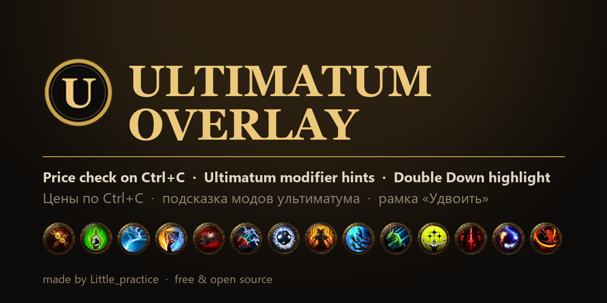
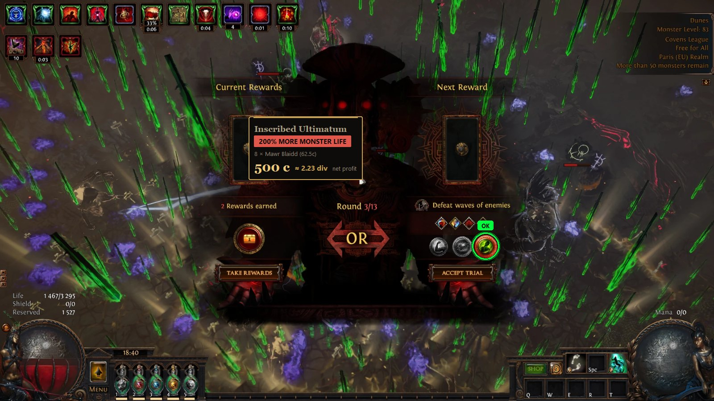
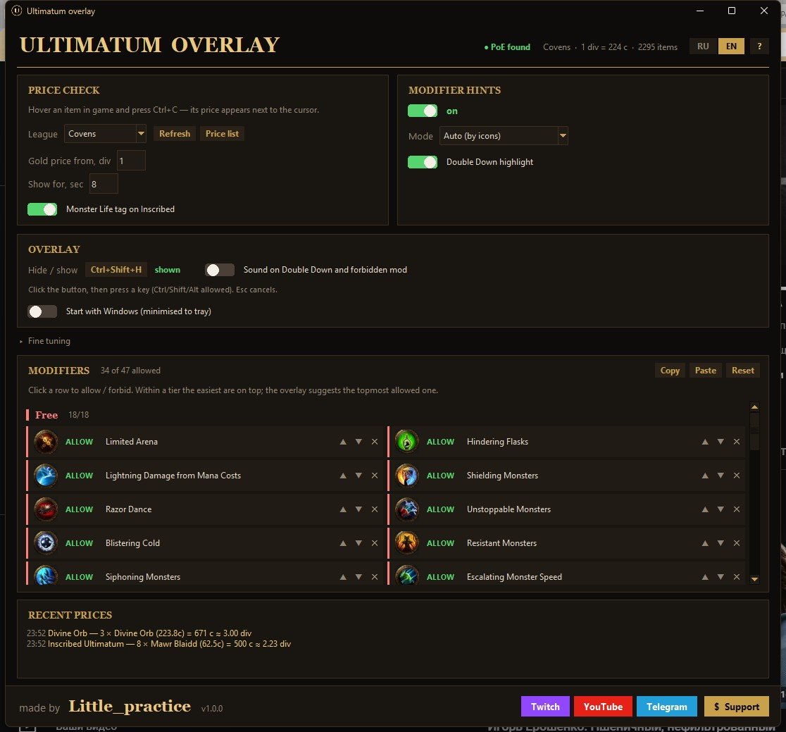

<p align="center"></p>

<p align="center">
  <a href="https://github.com/Little-practice/ultimatum-overlay/releases/latest"><b>⬇ Download / Скачать UltimatumOverlay.exe</b></a>
  &nbsp;·&nbsp; <a href="#русский">Русский</a> &nbsp;·&nbsp; <a href="#english">English</a>
</p>

---

## Русский

**Ultimatum Overlay** — умный оверлей и подсказки для механики Ультиматума в Path of Exile 1 поверх игры.
Программа **ничего не нажимает за игрока**: она только считывает экран и буфер обмена по вашему запросу и рисует информативные подсказки.

<p align="center"></p>

### Что умеет

- **Цена по Ctrl+C (все 48 категорий poe.ninja):** Наведи курсор на любой предмет в игре и нажми Ctrl+C — рядом мгновенно появится карточка цены с учётом размера стопки.
  - Поддерживаются валюта, фрагменты, карты, скарабеи, масла, фоссилы, сущности, татуировки, все виды уникальной экипировки и камней.
  - Метка `? неточные данные` для предметов с малым числом сделок на рынке.
  - Возможность задать свою фиксированную цену прямо в окне программы.
- **Предпросмотр наград Начертанного ультиматума:**
  - При оценке Начертанного ультиматума (Inscribed Ultimatum) у курсора отображается аутентичная внутриигровая карточка награды:
    - **Гадальные карты (Divination Cards):** официальный арт карты, размер стопки, награда с правильным цветом редкости и цитата.
    - **Уникальные предметы (Unique Items):** полный тултип с базой, требуемым уровнем, свойствами (implicits/explicits), цитатой и иконкой предмета.
  - Полный расчёт **чистой прибыли** (при удвоении/утроении награды или обмене предметов) и цветная плашка модификатора здоровья монстров (`70%`, `120%`, `200% more Monster Life`).
  - Опция включения/выключения карточки награды в настройках программы.
- **Все 2 065+ изображений вшиты в программу (работает офлайн):**
  - Все 471 гадальных карт и 1 594 уникальных предметов упакованы прямо в `.exe`. Изображения отображаются мгновенно и не требуют интернет-соединения.
- **Точная оценка камней и редких вариантов (Gems, Voices, Forbidden Jewels, Mageblood):**
  - Прайсчекер считывает точный уровень камня (1–21), качество (+0–23%) и статус осквернения (Corrupted), а также количество малых пассивок на `Voices` (1/3/5/7), нотаблы `Forbidden Flesh` / `Forbidden Flame` и число флаконов на `Mageblood`.
- **Подсказка усложнений (модов) по нажатию клавиши (100% GGG ToS Safe):**
  - Пассивный хоткей (по умолчанию `F2`, поддерживаются `Mouse3`/`Mouse4`/`Mouse5` и одиночные клавиши) срабатывает только внутри окна PoE и не блокирует `F2` в других программах Windows.
  - В окне ультиматума обводит самый простой разрешённый мод (для 10 волн) или показывает «можно / нельзя» на предложенном (для 13 волн).
  - Встроенный настраиваемый тир-лист из 47 модов, включая моды Миража.
- **Рамка вокруг «Удвоить» (Double Down):**
  - Заметная пульсирующая золотая рамка вокруг кнопки удвоения, которую невозможно пропустить.
- **Безопасное автообновление:**
  - Программа проверяет новые версии на GitHub Releases, тихо скачивает и проверяет SHA-256, и устанавливает обновление при следующем запуске (или по кнопке в шапке) — без перезапусков посреди боя.
- **Умный перезапуск (Single Instance):**
  - Если программа уже была запущена, повторный запуск чисто завершает старый экземпляр и открывает новый без блокировок и ошибок.
- **Не мешает другим прайсчекерам:**
  - Оверлей отличает физический Ctrl+C игрока от программного копирования сторонними утилитами (Awakened PoE Trade и др.).
- **Двуязычность и удобство:**
  - Полная поддержка клиента игры на русском и английском языках.
  - Сворачивание в трей, автозапуск с Windows, экспорт и импорт галочек модов («Копировать / Вставить»).

<p align="center"></p>

### Как начать
1. Скачай `UltimatumOverlay.exe` со страницы [Releases](https://github.com/Little-practice/ultimatum-overlay/releases/latest) и запусти.
2. Игра должна быть в режиме **«Оконный»** или **«Оконный без рамки» (Windowed Fullscreen)** — поверх эксклюзивного полноэкранного режима оверлей Windows не отображается.
3. Вверху окна программы должно загореться зелёным «● PoE найден». Подробная инструкция — кнопка «?».

### Безопасность
- Программа **не отправляет в игру нажатия клавиш и мыши**, не внедряется в память процесса игры и не модифицирует игровые файлы — полностью соответствует правилам GGG.
- **Открытый исходный код:** весь код прозрачен и открыт в этом репозитории.
- **Сборка на серверах GitHub:** релизные `.exe` компилируются через GitHub Actions напрямую из исходного кода с проверкой SHA-256.
- Настройки хранятся в `%APPDATA%\UltimatumOverlay`, рядом с `.exe` ничего лишнего не создаётся.

### Собрать самому
```bash
pip install -r requirements.txt pyinstaller
python -m PyInstaller --noconfirm UltimatumOverlay.spec
```
Или запустить из исходников: `python main.py`.

### Ошибки и идеи
[Issues](https://github.com/Little-practice/ultimatum-overlay/issues) — сообщить об ошибке или предложить улучшение.

---

## English

**Ultimatum Overlay** is an intelligent HUD and assistant for the Ultimatum mechanic in Path of Exile 1.
It **never automates gameplay or sends clicks**: it only analyzes screen regions and clipboard text on demand, drawing non-intrusive visual hints.

<p align="center"></p>

### Features

- **Price Check on Ctrl+C (all 48 poe.ninja categories):** Hover any item in game and press Ctrl+C — a price card instantly appears next to the cursor (stack-size aware).
  - Supports currency, fragments, divination cards, scarabs, oils, fossils, essences, tattoos, and all unique gear & gem classes.
  - `? approximate data` tag for items with low market trading volume.
  - Option to set your own custom price overrides.
- **Inscribed Ultimatum Reward Preview:**
  - Authentic in-game style preview card displayed next to the cursor when checking an Inscribed Ultimatum:
    - **Divination Cards:** authentic card art, stack badge, reward text with rarity colors, and flavour quote.
    - **Unique Items:** full tooltip with item base, required level, implicits, explicits, and icon.
  - Precise **net profit** calculation (handles double/triple rewards and item exchanges) and monster life mod badges (`70%`, `120%`, `200% more Monster Life`).
  - Toggle preview on/off in program settings.
- **2,065+ Bundled Offline Assets:**
  - All 471 divination cards and 1,594 unique items are packaged directly inside the `.exe` — zero load times, works 100% offline.
- **Accurate Gem & Multi-Variant Unique Pricing (Gems, Voices, Forbidden Jewels, Mageblood):**
  - Parses gem level (1–21), quality (+0–23%), and corrupted status, as well as `Voices` passive counts (1/3/5/7), `Forbidden Flesh` / `Forbidden Flame` notables, and `Mageblood` flask counts.
- **On-Demand Modifier Hints (100% GGG ToS Safe):**
  - Passive hotkey (default `F2`; supports `Mouse3`/`Mouse4`/`Mouse5` and standalone keys) triggers only when PoE is focused and never blocks `F2` in other Windows apps.
  - Highlights the easiest allowed modifier in 10-wave mode or displays allowed/forbidden on the given modifier in 13-wave mode.
  - Fully customizable tier list of 47 modifiers, including Mirage modifiers.
- **Double Down Highlight:**
  - Pulsing golden frame around the Double Down button so you never miss an opportunity.
- **Safe Background Auto-Updates:**
  - Queries GitHub Releases, downloads and verifies SHA-256 silently, and installs on next launch (or via the header button) — never restarting mid-combat.
- **Smart Relaunch (Single Instance):**
  - Running a new copy cleanly terminates any old running instance without conflict or "already running" errors.
- **Plays Well With Other Price Checkers:**
  - Distinguishes player Ctrl+C from external tools (Awakened PoE Trade, etc.).
- **Bilingual & Convenient:**
  - Full support for both English and Russian game clients.
  - System tray minimization, start with Windows, settings sharing (Copy / Paste).

<p align="center"></p>

### Getting started
1. Download `UltimatumOverlay.exe` from [Releases](https://github.com/Little-practice/ultimatum-overlay/releases/latest) and run it.
2. Run the game in **Windowed** or **Windowed Fullscreen** — overlays cannot draw over exclusive Fullscreen.
3. The top of the window will show green “● PoE found”. Click “?” for quick guidance.

### Safety
- Sends no keystrokes or mouse clicks to the game, never accesses game memory or modifies game files — compliant with GGG terms of service.
- **Open Source:** completely transparent and inspectable.
- **Built on GitHub Actions:** official executables are compiled on GitHub's secure runners with SHA-256 verification.
- User data is saved in `%APPDATA%\UltimatumOverlay`.

### Build it yourself
```bash
pip install -r requirements.txt pyinstaller
python -m PyInstaller --noconfirm UltimatumOverlay.spec
```
Or run directly from source: `python main.py`.

### Bugs and ideas
[Issues](https://github.com/Little-practice/ultimatum-overlay/issues) — report a bug or suggest a feature.

---

<p align="center">
  made by <b>Little_practice</b> ·
  <a href="https://www.twitch.tv/little_practice">Twitch</a> ·
  <a href="https://www.youtube.com/@Little_practice232">YouTube</a> ·
  <a href="https://t.me/little_practice_there">Telegram</a> ·
  <a href="https://www.donationalerts.com/r/little_practice">Support / Поддержать</a>
  <br>MIT License · Not affiliated with Grinding Gear Games.
</p>
